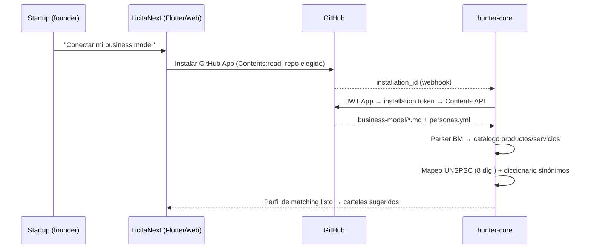

# Integración GitHub para ingesta de business models

> Análisis 2026-07-03 basado en la integración pre-existente de `dojocoding/dojo-os` (exploración solo lectura). Objetivo: onboarding "apuntá al repo de tu business model" → LicitaNext ingiere `business-model/` → deriva catálogo → UNSPSC → matching.

## Qué existe en dojo-os (y qué reutilizamos)

dojo-os (Vite/React + Supabase Edge Functions en Deno) tiene **tres** mecanismos GitHub:

| Mecanismo | Para qué lo usa dojo-os | ¿Útil para LicitaNext? |
|---|---|---|
| **A. OAuth de usuario** (Supabase Auth, scopes `read:user, user:email, repo, read:org`) → `provider_token` cifrado AES-GCM en `oauth_connections`, descifrado on-demand por Edge Functions | Ingesta de metadata de repos/actividad (GraphQL) | ✅ **El patrón a extraer**: OAuth → token cifrado → consumo server-side |
| **B. GitHub App** "Dojo Code Reviewer" (JWT RS256 → installation token ~1h, webhooks HMAC) | Review de PRs | Patrón de App útil como referencia; el caso de uso no |
| **C. PAT server-side** para seeding batch | Barridos masivos | No (anti-patrón para producto multi-tenant) |

**Archivos de referencia en dojo-os** (para extraer patrón, no importar):
- Motor de ingesta: `supabase/functions/_shared/github-detailed-ingestion.ts` (GraphQL, paginación, degradación graceful, fetch inyectable)
- Cifrado de tokens: `supabase/functions/_shared/token-crypto.ts`
- Flujo OAuth frontend: `src/services/profile-sync/oauthScopes.ts`, `src/services/profile-sync/OAuthConnectionService.ts`, `src/pages/AuthCallback.tsx`
- Mint de GitHub App token: `supabase/functions/_shared/dojo-code-reviewer-token.ts`

## Decisiones de diseño para LicitaNext

1. **GitHub App propia con `Contents: read` por repo** en lugar de OAuth scope `repo` completo: el usuario instala la App solo en el repo de su business model — mínimo privilegio, mejor narrativa de confianza (los business models son trade secrets). El patrón de mint de installation token se copia de dojo-os (B).
2. **Lo que dojo-os NO tiene y hay que construir**: lectura de **contenidos** de archivos (Contents API / GraphQL `object(expression:)`) — dojo-os solo lee metadata/actividad. El parser de `business-model/` (01-problema-hipotesis/, 02-solucion-validacion/, personas.yml) es 100% nuevo.
3. **Persistencia propia**: la capa de dojo-os asume su esquema de grafo de talento en Supabase; se reescribe contra el modelo de hunter-core (Postgres).
4. **Degradación graceful** heredada: timeouts con AbortSignal, truncado con warning, `null` en vez de excepción — mismo estilo para el pipeline de ingesta.

## Flujo objetivo

## Análisis de bifrost-keeper (chimeranext) — veredicto

Evaluado 2026-07-03 como candidato para el análisis de monorepos: **no aplica directamente** — es un reviewer de PRs con IA (CLI Bun/TS, loop tool-calling OpenAI-compatible contra NVIDIA NIM), no un analizador estructural. Sus 4 tools reales (`bifrost_github_pr_read`, `file_read`, `review_post`, `code_search`) son PR-céntricas; la única que serviría (`bifrost_github_repo_tree`) existe solo como nombre sin implementación. No expone MCP ni HTTP.

**Qué sí tomamos como referencia arquitectónica:**
- Patrón **Ports & Adapters** para GitHub (`src/lib/github-port.ts` + `src/adapters/fetch-github-adapter.ts`, `token-github-adapter.ts`) — plantilla limpia y testeable para el cliente GitHub de hunter-core (en Python).
- Loop LLM multi-proveedor barato (`src/lib/openai-agent-loop.ts` + `reviewer-providers.ts`) — concepto útil si el matching/parsing usa inferencia NIM/OpenRouter.

**Confirmado que hay que construir desde cero:** walker del árbol del repo (Contents API / `git/trees`), parser de markdown del formato business-model-toolkit, extracción de catálogo, mapeo UNSPSC.

## Análisis de dojo-agent-openclaw-plugin — EL GAP SE CIERRA

Evaluado 2026-07-03. **Este plugin tiene el walker + lectura de contenidos reales** que faltaban, y un hallazgo mayor: **dojo es el PRODUCTOR de los directorios `business/`** que LicitaNext consume — su tool `dojo_gh_bmc_write` (`src/tools/launchpad/gh-bmc-write.ts`) escribe el BMC con layout fijo (`business/01-problema-hipotesis/*.md`, `02-solucion-validacion/*.md`, `03-ejecucion-aceleracion/*.md`, `README.md`). El parser trabaja contra un esquema estable, no contra texto libre.

**Tools verificadas como implementadas** (OpenClaw plugin SDK, schemas TypeBox, `GitHubService` en `src/lib/github.ts`, 1074 líneas):
- `dojo_github_repo_tree` → `getRepoTree` (Git Trees API `recursive=1`, cap 1000 entradas) — el walker.
- `dojo_github_file_read` → `getFileContent` (Contents API, base64→utf8, cap 500KB) — el reader.
- `dojo_github_code_search`, `pr_read/list`, `commits`, `review_post/reply`, `gh_bmc_write`, `skill_write` — todas reales (contraste: el `repo_tree` de bifrost-keeper era stub).
- **Auth**: GitHub App (JWT RS256 → installation token con caché+refresh, env `DOJO_CODE_REVIEWER_APP_*`) — idéntica a nuestra decisión GitHub App + Contents:read.

**Decisión de integración (recomendación aceptada)**: portar a Python en hunter-core los 3 métodos (`getInstallationToken`, `getRepoTree`, `getFileContent`) — ~150 líneas con PyJWT + httpx, sin acoplamiento a OpenClaw. NO montar el Gateway completo solo para leer repos. El parser de markdown→catálogo se escribe nuevo contra el esquema de `gh-bmc-write.ts`, soportando ambos layouts: `business/` (formato dojo) y `business-model/` (formato portafolio).

## Pendientes

- Crear la GitHub App (nombre, permisos Contents:read, webhook URL) — requiere decidir org propietaria.
- Definir el contrato del parser: qué archivos del formato business-model-toolkit son fuente de verdad del catálogo (propuesta: `02-solucion-validacion/03-segmentos-de-mercado.md` + `08-fuentes-de-ingresos.md` + `personas.yml`).
- Fallback para business models que no viven en GitHub: upload manual de un ZIP/carpeta.
