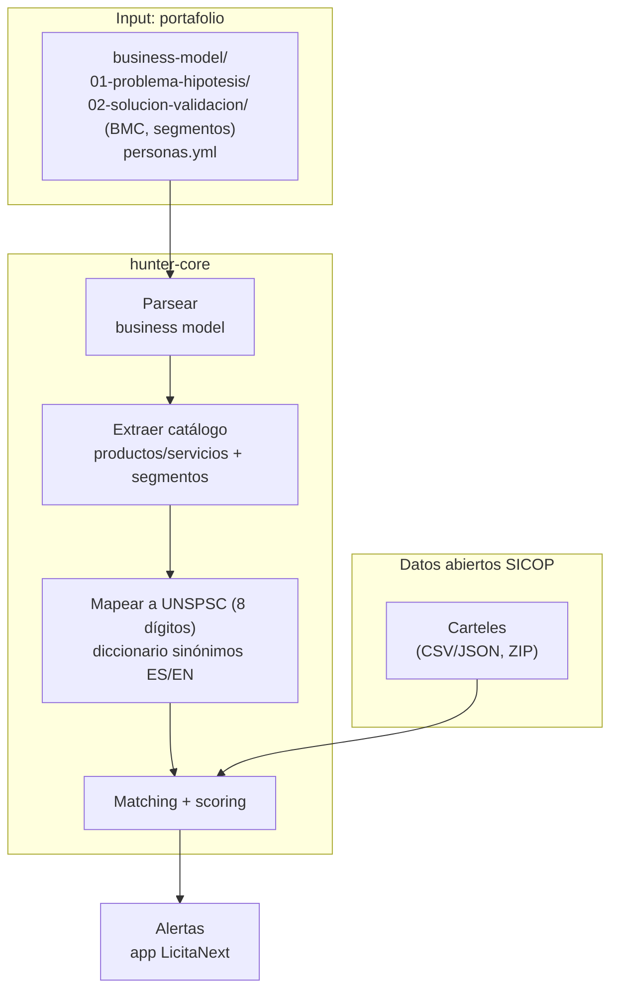

# Arquitectura de hunter-core

`hunter-core` es el cerebro de ingesta y match de LicitaNext. Su trabajo es
convertir los **datos abiertos de SICOP** en alertas de carteles relevantes
para cada cliente.

## Pipeline objetivo

```
┌────────────────────┐   ┌──────────────────┐   ┌───────────────────┐
│ Ingesta datos      │   │ Match UNSPSC     │   │ Alertas           │
│ abiertos SICOP     │──▶│ (perfil cliente  │──▶│ (push / email /   │
│ (CSV/JSON, ZIP)    │   │  ↔ código cartel)│   │  app LicitaNext)  │
└────────────────────┘   └──────────────────┘   └───────────────────┘
```

1. **Ingesta**: descarga y normalización de los volcados de datos abiertos
   SICOP (reportes de contratos, diccionario en `docs/sicop/`). Formatos
   CSV/JSON, entregas periódicas (p. ej. `202606.zip`).
2. **Match UNSPSC**: cada cartel trae uno o más códigos UNSPSC; se cruzan
   contra el perfil de intereses de cada cliente para puntuar relevancia.
3. **Alertas**: los matches con score alto generan notificaciones hacia la
   app LicitaNext.

Hoy el servicio expone sólo el esqueleto (`/health`, `/api/v1/carteles`
devolviendo lista vacía). Las tres etapas se irán conectando detrás de esos
endpoints.

## Input: modelos de negocio del portafolio

Además de los datos de SICOP, LicitaNext acepta como **input** los directorios
`business-model/` estandarizados del portafolio, en el formato del
**business-model-toolkit**:

```
business-model/
├── 01-problema-hipotesis/     # problema, hipótesis, segmentos
├── 02-solucion-validacion/    # Business Model Canvas (BMC), propuesta de valor
└── personas.yml               # personas objetivo (cuando existe)
```

De ese modelo de negocio se deriva **qué vende** cada cliente (catálogo de
productos/servicios) y **a quién** (segmentos), que es exactamente lo que hay
que cruzar contra los carteles de SICOP. El pipeline planeado:

1. **Parsear el business model** — leer `01-problema-hipotesis/` y
   `02-solucion-validacion/` (BMC, segmentos) y `personas.yml` si existe.
2. **Extraer catálogo** — productos/servicios ofrecidos y segmentos de cliente.
3. **Mapear a UNSPSC** — traducir cada producto/servicio a uno o más códigos
   **UNSPSC de 8 dígitos**, usando un **diccionario de sinónimos ES/EN**
   (los carteles y catálogos usan terminología mixta español/inglés).
4. **Matching contra SICOP** — cruzar esos códigos UNSPSC contra los carteles
   de los datos abiertos SICOP y puntuar la relevancia.



## Firma digital

Los procesos de contratación en SICOP requieren **firma digital** costarricense.
El diseño de esa integración (Gaudí) se documenta aparte en
[`docs/firma-digital-gaudi.md`](../../../docs/firma-digital-gaudi.md) del
monorepo.

## Despliegue: Minikube primero, KNative después

- **Ahora (Minikube):** `hunter-core` se despliega como un `Deployment`
  normal + `Service` ClusterIP en el namespace `licitanext-dev`
  (ver `k8s/base/hunter-core/` y `k8s/overlays/dev/`).
- **Después (KNative):** la ingesta es un trabajo intermitente (bursts al
  llegar un nuevo volcado de datos), buen candidato para *scale-to-zero*.
  Cuando el pipeline esté maduro, el `Deployment` se migrará a un
  `Service` de KNative Serving (`serving.knative.dev/v1`). Hasta entonces
  los manifests son Deployment/Service estándar a propósito.
